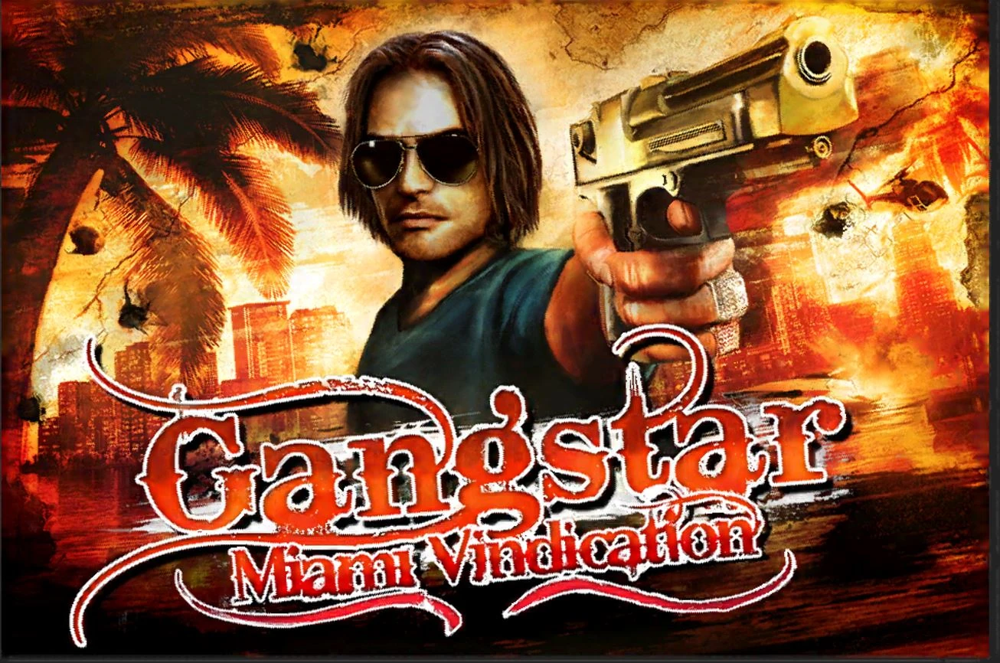

<p align="center">
  
</p>

# Gangstar: Miami Vindication · PC Port

<p align="center">
  <a href="https://github.com/Adriansyah101/Gangstar-Miami-Vindication-PC-Port/releases/latest"></a>
  <a href="LICENSE"></a>
  
  
  <a href="https://github.com/Adriansyah101/Gangstar-Miami-Vindication-PC-Port/releases"></a>
</p>

<p align="center">
  <a href="#features">Features</a> •
  <a href="#system-requirements">Requirements</a> •
  <a href="#setup-instructions-for-players">How to install</a> •
  <a href="#controls">Controls</a> •
  <a href="#troubleshooting">Troubleshooting</a> •
  <a href="#known-issues">Known Issues</a> •
  <a href="PATCHNOTES.md">Patch Notes</a> •
  <a href="#privacy">Privacy</a> •
  <a href="#build-instructions-for-developers">How to compile</a> •
  <a href="#contributing">Contributing</a> •
  <a href="#credits">Credits</a> •
  <a href="#license">License</a>
</p>

Gangstar: Miami Vindication is a 2011 open-world action game by Gameloft. It is set in Miami and played on foot, by
car and in the air, with story missions, side missions and races.

This repository contains a Windows and Linux loader for **the macOS i386 release of the game, version 1.0.0**, for
PCs with an **x86 processor (Intel or AMD)**. There is no CPU emulation, because the game is already x86. A custom Mach-O loader runs the official executable at its own
addresses, and host shims supply the macOS libraries it imports, in the spirit of Wine or Darling.

The port runs the game with the fixes it needs on a PC, and adds optional extras, which are on by default. One
setting, `ORIGINAL_MAC_EXPERIENCE`, turns them all off and plays the game as the Mac did.

## Features

The main additions, all switchable in the game under **OPTIONS**, then **GAMEPATCH**:

| Feature | Option | Default | `ORIGINAL_MAC_EXPERIENCE` |
|---|---|---|---|
| Frame rate up to 400 fps | `FRAME_MS` | 60 fps | 30 fps, as on the Mac |
| Ambient occlusion | `AMBIENT_OCCLUSION` | on | off |
| Bloom, with glowing lights and windows | `BLOOM` | 2 | off |
| Reflections on the sea and on shiny cars | `WATER_REFLECTIONS` `VEHICLE_REFLECTIONS` | on | off |
| Shadows that follow the sun and the moon | `DYNAMIC_SHADOWS` | on | off |
| The iPhone version's sun and moon | `SUN_MOON` | on | off |
| Fog over the whole city | `FOG_MODE` | 2 (hybrid) | the game's own |
| Sharper textures at a distance | `ANISOTROPIC_FILTERING` | 16x | off |
| Longer draw distance | `DRAW_DISTANCE` | 2x | 1x |
| More traffic and people | `TRAFFIC_DENSITY` `PEDESTRIAN_DENSITY` `PARKED_CAR_DENSITY` | 3x | 1x |
| Gamepad menus, GTA V-like layout, pad hints and icons | `PAD_MENU` `PAD_LAYOUT` `PAD_HINTS` `PAD_ICONS` | on | off |
| W/A/S/D diagonals and smooth turns | `KEY_MOVE` | on | off |
| Replay completed missions | `MISSION_REPLAY` | on | off |
| A radio station for your own music | `CUSTOM_RADIO` | on | off |

[**Patch Notes**](PATCHNOTES.md) lists every fix and addition.

## Disclaimer

**Gangstar: Miami Vindication** is a trademark of Gameloft, and the game and its assets are the property of their
respective owners. This is a fan project. It is not official, and Gameloft has not made, approved or supported it.

The authors of this work do not promote or condone piracy in any way. The game is not included, and to use this
software you need your own legally obtained copy of the Mac `GangstarMV.app`. Nothing from another version of the
game is included either.

> [!NOTE]
> The banner above is the game's art. The game's icon is built into the Windows, Linux and `-dev` programs, and the
> `-noicon` programs have no game art at all.

## System Requirements

| | Windows | Linux |
|---|---|---|
| Processor | x86 (Intel or AMD), 64-bit or 32-bit | 64-bit x86 (Intel or AMD) |
| System | Windows 10 or 11. Tested on Windows 11; older versions have not been tried | 64-bit x86 with 32-bit support and glibc 2.35 or newer. Tested on Debian 13 (in WSL2) |
| Libraries | Included (`SDL3.dll`) | 32-bit SDL 3.2 or newer, OpenGL, FreeType and fontconfig; `ffmpeg` for the intro (see below) |
| Graphics | OpenGL 2.1 with framebuffer objects, for the anti-aliasing and the graphics options. Tested on an NVIDIA RTX 3050 Ti | the same |
| Memory | The game used about 230 MB in the city with every option on, at 1920x1080 | the same |
| Disk | About 800 MB for the game, 7 MB for the port | About 800 MB for the game, 2 MB for the port |

**x86 processors only (Intel or AMD).** The program is 32-bit x86 code, like the game, and runs it as it is, with no
emulation. **Not supported:** ARM processors, such as Linux on a Raspberry Pi or an ARM board, and Apple Silicon;
and macOS, where the original game runs as it is. Windows on ARM (Snapdragon PCs) runs x86 programs through its own
emulation, but the port has not been tried there.

## Setup Instructions (For Players)

1. Get your own copy of the Mac version, `GangstarMV.app`.

   > [!IMPORTANT]
   > The port works with **one build only**, and it refuses any other. SHA-1 of
   > `GangstarMV.app/Contents/MacOS/GangstarMV` **must** be `7d3140b15658b492b6903eb424767abe348480ec`.
   >
   > To check yours on Windows: `certutil -hashfile "GangstarMV.app\Contents\MacOS\GangstarMV" SHA1`
   >
   > On Linux: `sha1sum GangstarMV.app/Contents/MacOS/GangstarMV`

2. Go to [**Releases**](https://github.com/Adriansyah101/Gangstar-Miami-Vindication-PC-Port/releases/latest) and
   download the file for your system:

   | System | File |
   |---|---|
   | Windows | `GangstarMV-PC-Port-V1.0.0-Windows.zip` |
   | Linux | `GangstarMV-PC-Port-V1.0.0-Linux.tar.gz` |

   Each also comes as `-noicon`, with no game icon, and as `-dev`, for people working on the port.

   To check that the download is intact, compare it with `SHA256SUMS.txt` on the same page: on Windows,
   `certutil -hashfile <file> SHA256`; on Linux, `sha256sum -c SHA256SUMS.txt --ignore-missing` in the download folder.

3. Extract it.
4. Replace the empty `GangstarMV.app` folder inside it with your copy, so that
   `GangstarMV.app/Contents/MacOS/GangstarMV` is there.
5. Start it:
   - **Windows:** double-click `GangstarMV.exe`. Keep `SDL3.dll` and `gmv_patch.bin` next to it.
   - **Linux:** run `./GangstarMV` in its folder. Keep `gmv_patch.bin` next to it. On Debian 13 or Ubuntu 25.04 and
     newer, install the 32-bit libraries first:

     ```sh
     sudo dpkg --add-architecture i386
     sudo apt update
     sudo apt install libsdl3-0:i386 libgl1:i386 libgl1-mesa-dri:i386 libfreetype6:i386 libfontconfig1:i386 ffmpeg
     ```

     `ffmpeg` plays the intro movie and the custom radio's m4a, aac and wma songs; without it the intro is skipped.
     Ubuntu 24.04 and older have no SDL3 package. With NVIDIA's own driver, install its 32-bit libraries too.

The port creates two folders next to the program on the first run: `savegame` holds your save and `GangstarMV.ini`,
and `cache` holds the game's scratch files and `GangstarMV.log`.

**Settings:** most options are in the game, under **OPTIONS**, then the **GAMEPATCH** tab. The rest are in
`savegame/GangstarMV.ini`, and deleting that file restores the defaults. [`FIXES.txt`](FIXES.txt) explains them in
plain words.

**Your own music:** put songs in the `custom radio` folder (mp3, ogg, flac, wav, m4a, aac or wma). In a car, switch to
the sixth station.

**Add-ons:** the `add-on` folder is for two optional extras that you make from your own copies of other versions
of the game. None is included, and the game plays the same without them. The note in that folder explains them.

### Updating, backing up and uninstalling

- **Your progress** is in the `savegame` folder: `Gangstar2.sav` (the save), `Gangstar2.preferences` (the game's own
  settings) and `GangstarMV.ini` (the port's settings). To back up, copy that folder.
- **To update,** extract the new version to a new folder, put the game in it as before, and copy the old `savegame`
  folder into it. Copy your `custom radio` songs and `add-on` files over too, if you have any.
- **To uninstall,** delete the folder. The port keeps everything in its own folder.
- **`cache` is safe to delete** at any time. It is made again at the next start.
- A save from the Mac version itself has not been tried.

### Command line

| Option | What it does |
|---|---|
| `--app "<path to GangstarMV.app>"` | Use a copy of the game kept somewhere else. Without it, the port looks next to itself, then one folder up |

## Controls

The game's own controls are under **OPTIONS**, then **CONTROLS**. The port adds these:

| Input | Action |
|---|---|
| **Alt+Enter** | Switch between full screen and a window |
| **Alt+F4** or closing the window | Quit, like closing the Mac window. Progress since the last save is lost |

These come from options that are on by default:

| Option | Input | Action |
|---|---|---|
| `KEY_MOVE` | **W/A/S/D** | Walk diagonally and turn smoothly |
| `KEY_MOVE` | Hold **Alt** | Walk instead of run |
| `CUTSCENE_KEYS` | **Esc** or **Enter** | Skip a cutscene |
| `CUTSCENE_KEYS` | **Space** | Next line of dialog |
| `TUTORIAL_KEYS` | **Esc**, **Enter** or **Space** | OK in a tutorial popup |
| `TUTORIAL_KEYS` | **Enter** or **Space** / **Esc** | YES / NO in a question popup |
| `PAD_MENU` | Left stick or D-pad | Move the menu pointer |
| `PAD_MENU` | **A** (cross) / **B** (circle) | Click / go back |

Xbox, PlayStation and other pads work in play. `PAD_LAYOUT` gives them a layout like GTA V's, listed in
[`FIXES.txt`](FIXES.txt). On a French or Belgian keyboard the player moves with Z Q S D, as on the Mac.

## Performance Tips

Most of the work is on the processor: a longer draw distance and bigger crowds give the physics and the people more
to do. The graphics options weigh on the graphics card. On a slower PC, in this order:

1. Lower `DRAW_DISTANCE` and the three density options, to 1 (the Mac's) or 2.
2. On integrated graphics, turn off `AMBIENT_OCCLUSION`, `WATER_REFLECTIONS`, `VEHICLE_REFLECTIONS` and
   `DYNAMIC_SHADOWS`, and set `BLOOM` to 1 or off.
3. Set `MSAA` to 2 or 0 in `GangstarMV.ini`.
4. Play at 30 fps, as on the Mac: `FRAME_MS=16.6667`.

## Troubleshooting

| Problem | What to do |
|---|---|
| "The game was not found" | The `GangstarMV.app` folder must be next to the program, with `Contents/MacOS/GangstarMV` inside it, or given with `--app` |
| "...could not load the game: its files do not match what this port expects" | Your copy is a different build of the game. Check its SHA-1 (step 1 above): only that one build works |
| "gmv_patch.bin is missing" | Keep `gmv_patch.bin` in the same folder as the program |
| Windows: "SDL3.dll was not found" | Keep `SDL3.dll` in the same folder as `GangstarMV.exe` |
| Windows: "Windows protected your PC" (SmartScreen) or an antivirus warning | The exe is not digitally signed, and a new program with few downloads gets this warning. Click **More info**, then **Run anyway**. The source is all here, so you can build the exe yourself, and `SHA256SUMS.txt` lets you check the download |
| Linux: `./GangstarMV: No such file or directory`, though the file is there | The system's 32-bit support is missing. Install the packages in step 5 (they bring `libc6:i386`) |
| Linux: `error while loading shared libraries: libSDL3.so.0` | Install the 32-bit SDL3 package, as in step 5 |
| Linux: `Permission denied` | Run `chmod +x GangstarMV` once |
| Linux: the intro is skipped | Install `ffmpeg` |
| Z Q S D do not move you on an AZERTY keyboard | The keys are kept in `savegame/Gangstar2.preferences`. Delete that file once (the game's own settings in it start over) |
| The game feels choppy with `ORIGINAL_MAC_EXPERIENCE` | It runs at 30 fps, as the Mac did. Turn the preset off for 60 fps |
| A black screen, a crash or an error box | Report it (see below) with `cache/GangstarMV.log` |

## Known Issues

1. **Only an NVIDIA GPU has been tested** (RTX 3050 Ti on Windows 11). Nothing has been run on AMD or Intel, and the
   optional graphics use their own shaders, so those are the most likely to differ.
2. **Linux has run in WSL2 only** (Debian 13, with Mesa's software renderer). It has not been tried on a Linux machine
   with a real GPU yet.
3. **One crash not explained:** a fault was seen once while replaying MIAMI BOUND! after switching
   `ORIGINAL_MAC_EXPERIENCE`. It did not come back in three more replays, and the cause is not proved.
4. **Offline only.** Gameloft's services are long gone, so the game's online buttons report no connection.

### Reporting a bug

Open an issue on the [**Issues**](https://github.com/Adriansyah101/Gangstar-Miami-Vindication-PC-Port/issues/new/choose)
page. The bug report form asks for:

- your system and its version, and your graphics card and driver;
- the port's version, and which download you use (Windows or Linux; normal, `-noicon` or `-dev`);
- what happened, and the steps that lead to it;
- `cache/GangstarMV.log`, attached as a file. It lists the settings you changed, so they need not be written out.

After a crash there is also `cache/GangstarMV.dmp`. Attach it only if you are happy with what the
[Privacy](#privacy) section says about it.

## Privacy

The port has no network code and sends nothing anywhere: it links no network library.

`cache/GangstarMV.log` stays on your computer until you choose to send it. It records your settings, graphics card
and driver, display modes and controller names. Your user folder, the program's folder and the game's folder appear
in it as `%USERPROFILE%` (`$HOME` on Linux), `%EXE%` and `%APP%`. A release log does not name your songs. The log of
the `-dev` build does, and it is much longer, so read it before you send it.

After a crash, `cache/GangstarMV.dmp` holds what the port's threads were doing: registers, stacks and the loaded
modules. The folders above, your environment variables and the computer's name are blanked in it, but it is raw memory,
so it can hold other scraps, such as a song's file name. It stays on your computer until you choose to send it, and the
next start deletes it.

`LOG=0` turns off both the log and the crash dump.

## Build Instructions (For Developers)

The build is CMake (`host/CMakeLists.txt`). You need:

- your copy of the game, as above;
- Python 3 with Capstone (`pip install capstone`), for the patch table;
- **Windows:** [MSYS2](https://www.msys2.org/) at `C:\msys64` with its 32-bit toolchain:
  `pacman -S mingw-w64-i686-gcc mingw-w64-i686-cmake mingw-w64-i686-ninja`;
- **Linux:** a 32-bit gcc and the 32-bit development files. On Debian or Ubuntu, after
  `sudo dpkg --add-architecture i386`:
  `sudo apt install gcc-multilib cmake ninja-build libsdl3-dev:i386 libgl-dev:i386 libfreetype-dev:i386`.

Clone this repository and put your `GangstarMV.app` in its folder. Then, on Windows, in PowerShell:

```powershell
cd Gangstar-Miami-Vindication-PC-Port
mkdir build

# SDL3, once: the official 32-bit build, one pinned version, into host\third_party
tools\get_sdl3.ps1

# the patch table for the game's low code range, once per binary
py -3 -I tools\genlow.py GangstarMV.app\Contents\MacOS\GangstarMV build\gmv_patch.bin

# build\release\GangstarMV.exe, with SDL3.dll next to it
host\build.ps1 -Release
copy build\gmv_patch.bin build\release\

build\release\GangstarMV.exe --app "$PWD\GangstarMV.app"
```

If PowerShell blocks a script, run it as `powershell -ExecutionPolicy Bypass -File <script>`.

On Linux:

```sh
cd Gangstar-Miami-Vindication-PC-Port
mkdir -p build
python3 -I tools/genlow.py GangstarMV.app/Contents/MacOS/GangstarMV build/gmv_patch.bin

# build/linux/gangstar/release/GangstarMV
BUILD=release sh host/linux/build.sh gangstar
cp build/gmv_patch.bin build/linux/gangstar/release/

build/linux/gangstar/release/GangstarMV --app "$PWD/GangstarMV.app"
```

| Windows | Linux | Use |
|---|---|---|
| `host\build.ps1` | `sh host/linux/build.sh gangstar` | Daily work: every diagnostic, `-g`. It holds local paths, so never share it |
| `host\build.ps1 -Dev` | `BUILD=dev sh host/linux/build.sh gangstar` | Every diagnostic, symbols stripped |
| `host\build.ps1 -Release` | `BUILD=release sh host/linux/build.sh gangstar` | Public build: no debug mode, symbols stripped |

The source has no icon, because the icon is the game's art, so your program is built without one.

| Where | What |
|---|---|
| [`host/core/`](host/core) | The loader, which knows no game |
| [`host/shims/`](host/shims) | The macOS libraries, which know no game |
| [`host/games/gangstar/`](host/games/gangstar) | This game's fixes, enhancements and add-ons |
| [`host/games/template/`](host/games/template) | A game with no patches, for starting another |
| [`tools/`](tools) | The patch table generator, SDL3 fetcher, playtest runner, Mach-O and Objective-C analysis, add-on packers |
| [`docs/README.md`](docs/README.md) | The source's own README: status, settings, what has been tested |
| [`docs/NOTES.md`](docs/NOTES.md) | The long form: how the loader and shims work, every graphics setting, each fix with its evidence, the diagnostics |
| [`CHANGELOG.md`](CHANGELOG.md) | Everything the port does, by part ([`CHANGELOG_old.md`](CHANGELOG_old.md): the older record, by version) |

## Contributing

Help is welcome, and the most useful help right now needs no code at all:

- **Play it on hardware that has not been tried:** an AMD or Intel GPU, Linux on a real GPU, the Steam Deck.

Report what you find on the [Issues](https://github.com/Adriansyah101/Gangstar-Miami-Vindication-PC-Port/issues)
page, with the log, even when everything works. For code, [`CONTRIBUTING.md`](CONTRIBUTING.md) explains how the
project is laid out, the rules it keeps and how changes are tested.

## Credits

- **[Adriansyah101](https://github.com/Adriansyah101)**, for the port.
- **Gameloft**, for the game.
- **[SDL](https://www.libsdl.org/)**, for the window, input, sound and gamepads.
- **[dr_libs](https://github.com/mackron/dr_libs)** and **[stb_vorbis](https://github.com/nothings/stb)**, for the
  custom radio's decoders.
- **[MSYS2](https://www.msys2.org/)** and **[mingw-w64](https://www.mingw-w64.org/)**, for the Windows toolchain.
- **[Capstone](https://www.capstone-engine.org/)**, for the disassembler behind the patch table.

## License

This software may be modified and distributed under the terms of the MIT license. See the [`LICENSE`](LICENSE) file
for details.

The license covers this project's own code and documents. It does not cover the game, the game's icon or the banner
art, which stay under their owners' terms. SDL3 is under the zlib license, and dr_libs and stb_vorbis carry their own
licenses at the end of each file.
